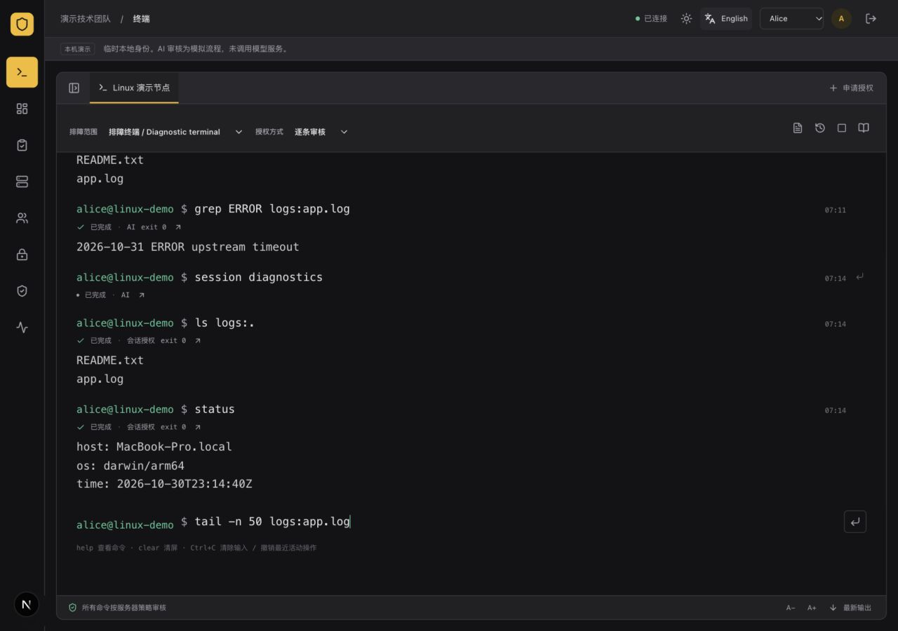
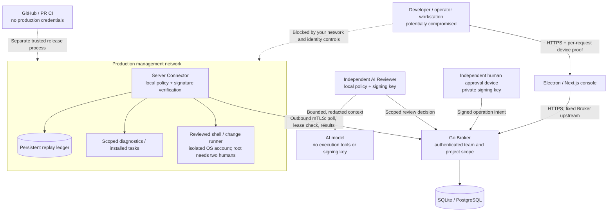

<div align="center">
    <h1>🛡️ safe-devops</h1>
    <h3><em>Open-source DevSecOps access control for development and operations teams</em></h3>
</div>

<p align="center">
    <strong>Secure server operations for development and operations teams, with device-bound access, reviewed shell commands, and AI or human approval. Built with Go, Next.js and Electron; self-hosted with SQLite or PostgreSQL.</strong>
</p>

<p align="center">
    <a href="https://github.com/0xfnzero/safe-devops/releases">
        
    </a>
    <a href="https://github.com/0xfnzero/safe-devops/actions/workflows/ci.yml">
        
    </a>
    <a href="https://github.com/0xfnzero/safe-devops/blob/main/LICENSE">
        
    </a>
    <a href="https://github.com/0xfnzero/safe-devops">
        
    </a>
    <a href="https://github.com/0xfnzero/safe-devops/network">
        
    </a>
</p>

<p align="center">
    
    
    
</p>

<p align="center">
    <a href="https://github.com/0xfnzero/safe-devops/blob/main/README.zh-CN.md">中文</a> |
    <a href="https://github.com/0xfnzero/safe-devops/blob/main/README.md">English</a> |
    <a href="https://fnzero.dev/">Website</a> |
    <a href="https://t.me/fnzero_group">Telegram</a> |
    <a href="https://discord.gg/vuazbGkqQE">Discord</a>
</p>

safe-devops is a **self-hosted DevSecOps platform for secure server access and operations approval**, built with Go, Next.js and Electron. It helps contain the impact of a compromised developer or operator workstation: production servers independently verify narrowly scoped, signed operations instead of trusting a personal workstation's SSH session.

Use a familiar command interface for diagnostics and approved tasks. Automatically allow explicitly permitted low-risk operations, send other eligible commands to an AI reviewer, and hand uncertain or high-risk operations to independent human reviewers. Keep teams, projects, servers, approvals and audit records in one control plane.



## Why safe-devops?

A stolen developer SSH key, GitHub credential or workstation session should not automatically become unrestricted production access. safe-devops separates **requesting an operation**, **approving its scope**, and **executing it on a server**.

- **Outbound server connectivity:** Server Connectors initiate mTLS connections to the Broker; operators do not receive production SSH keys.
- **Device-bound access:** enrolled Ed25519 device keys sign every authenticated request, binding identity, method, path, body, timestamp and a one-time nonce. IP restrictions are optional.
- **Layered command approval:** explicitly allowed `ls` / `status` operations can pass local rules; other eligible commands use AI review, with human escalation and visible status.
- **Independent execution checks:** the Connector checks signatures, local tools and paths, expiry, use counts, tenant and project scope, and replay state before execution.
- **AI risk review with guardrails:** recent scoped operations and redacted output inform assessments. The model has no execution tools or signing keys; high-risk changes require humans.
- **Account containment:** risk decisions can temporarily lock a requester and revoke active grants. Early recovery requires an independent human signature.
- **Multi-tenant collaboration:** multiple teams, members, projects and servers, with project-scoped access and team audit visibility.
- **Self-hosted deployment:** SQLite by default, optional PostgreSQL, Docker Compose, Linux systemd services, backups and restore tooling.
- **Web and desktop console:** continuous terminal output, history, completion, scoped sessions, Chinese/English and light/dark themes.

This is an early public release with automated tests, not an independently audited security product. Network isolation and removal of alternative workstation-to-production access remain deployment responsibilities. Start in a controlled environment and review the [security boundaries](docs/architecture.md) and [validation record](docs/validation.md).

## Architecture and trust boundaries



**Server Connector** executes authorized operations. **AI Reviewer** assesses operations and signs permitted decisions. These are separate roles; the AI model is not a server execution agent.

The Broker terminates Connector mTLS directly. Never treat a forwarded `X-Client-Cert` header as Connector authentication. Prevent direct workstation SSH/cloud access through your network and identity policies; the project does not automatically alter firewalls or remove existing keys. See [GitHub credential containment](docs/github-security.md).

## Quick start

Requirements: **Go 1.26+**, **Node.js 22.18+** (24 recommended), npm, **Python 3.11+**, GNU Make and Bash. Use macOS, Linux or WSL for the full development environment.

```bash
git clone https://github.com/0xfnzero/safe-devops.git
cd safe-devops
make                  # List every command and description
make setup            # Install Go/Web dependencies and build the local CLI
make dev              # Broker, two Connectors, simulated Reviewer and Next.js
```

Open [http://127.0.0.1:3000](http://127.0.0.1:3000). Alice requests operations, Bob and Carol review them, and Dave is isolated to a separate project. The demo stores disposable state in `.safeops/v4`; its AI reviewer is explicitly simulated and does not call a model service. Newly created demos include a shell running as your current non-root OS user after the required review; use a disposable development machine. Older demo configuration is preserved and must be recreated in a new `DEV_DIR` to enable this capability. Ctrl+C stops the services started by that command.

To use the Electron client:

```bash
make setup-desktop
make desktop          # Connect the launcher to the running local console
# Or start both backend/Web and Electron together:
make dev-desktop
```

Do not expose the local demo to a public network. Production configuration uses separate credentials, device enrollment and trusted TLS.

## Terminal workflow

Choose a project, server and diagnostic scope, then enter a command:

```text
ls
status
cat logs:app.log
tail -n 50 logs:app.log
grep 'ERROR' logs:app.log
run disk-usage
plan demo-change check verify
```

`logs` names an administrator-approved directory. Paths may vary within the allowed scope; you do not need a separate template for every log file. `grep` performs literal-text search.

Use individual review for each command, or explicitly select a short-lived approved diagnostic session with a bounded directory, tool set and execution budget. Session operations still validate identity and machine, consume a use, check revocation and enter audit/risk review. Approval does not execute a diagnostic command by itself.

**General shell commands can be submitted without a fixed command template**, including pipelines, redirection and installation commands, when the reviewed shell executor is configured. A small exact diagnostic set may pass rules or AI review; unknown, mutating and complex shell commands require independent human approval. Every shell grant is single-use and binds the command, working directory, OS account, server and expiry. Root execution requires two humans. The directory is a starting location, not a sandbox; each command starts fresh (`cd /path && command`). Full-screen interactive programs such as `vim`/`top` are not yet supported.

Details: [terminal and desktop](docs/terminal.md), [AI review and guardrails](docs/ai-review.md), [account risk controls](docs/account-risk.md), [device enrollment](docs/device-access.md).

## Docker Compose deployment

The default control-plane stack contains Broker, Web and an HTTPS gateway. **PostgreSQL is optional; SQLite works without a database server.** Run Connectors on target servers and reviewers in a separate approval trust domain.

Prepare the independent reviewer's Base64 public key and the client's SSH Ed25519 device public key as two files. Keep private approval keys on the approval device.

```bash
make build
make deploy-init CONFIG_DIR=.safeops/production \
  WORKSPACE=acme PROJECT=payments \
  BROKER_URL=https://broker.example.com:8443 \
  WEB_URL=https://ops.example.com \
  APPROVER_PUBLIC_KEY_FILE=/secure/reviewer.pub \
  DEVICE_PUBLIC_KEY_FILE=/secure/device.pub \
  DIAGNOSTIC_ROOT=/srv/app/logs

make deploy-up
make deploy-status
make deploy-health
```

Add `DATABASE=postgres` **during initialization** to select PostgreSQL. Startup reads the persisted database choice. Existing databases require a backup/restore migration, not an option toggle.

Initialization refuses to overwrite existing configuration. It generates a private CA and separate service credentials, binds published ports to loopback by default, and keeps CA private material outside container mounts. Configure DNS, a trusted PKI or trust the generated CA, and set the management-network bind address before remote access. Never skip TLS verification.

The complete guide covers Connector installation, multi-team configuration, TLS, systemd, upgrades and recovery: [deployment guide](docs/deployment.md).

## Build, package and operate

```bash
make check                                  # Go, Web, desktop and script checks
make package-servers VERSION=0.4.2           # Linux/macOS × amd64/arm64 CLI
make package-web VERSION=0.4.2               # Current platform's Next standalone
make package-desktop VERSION=0.4.2           # Current OS/architecture installer
make release VERSION=0.4.2                   # CLI packages, local Web and source

make deploy-logs SERVICE=broker
make deploy-backup WORKSPACE=acme
make deploy-upgrade VERSION=0.4.2             # Validate + back up all teams first
```

Artifacts go to `dist/` with version/platform names and SHA-256 checksums. Desktop commands `package-macos`, `package-windows` and `package-linux` run on the corresponding operating system. Production server services target Linux; macOS CLI packages support administration and development. Web bundles must be built for the deployment OS/architecture. See each [Release](https://github.com/0xfnzero/safe-devops/releases) for available binaries and signing/validation notes.

The [command reference](docs/commands.md) documents setup, platform selection, Compose lifecycle, restore, policy migration and systemd installation. `make` always shows the full command list.

## Security scope

- Device signatures prove possession of a software key, not hardware attestation. A stolen decrypted key plus credentials, or a still-controlled enrolled workstation, remains a threat.
- A compromised requester may use the remaining scope and budget of an existing authorization. Keep scopes narrow and use independent review for consequential changes.
- AI may misjudge operations within its permitted scope or cause false-positive locks. Deterministic server policy limits its authority; model confidence is not a security proof.
- A compromised Connector host, approval quorum, writable runbook executable or alternative SSH/cloud path can break the intended isolation.
- SQLite is intended for a single node and controlled scale. PostgreSQL does not by itself provide complete high availability. State/audit growth and disaster recovery need deployment-specific validation.
- Member and project configuration is administrator-managed. Public registration, invitations, OIDC, billing and online permission editing are not implemented.

Read the [architecture](docs/architecture.md), [protocol](docs/protocol.md), [security policy](SECURITY.md) and [test evidence](docs/validation.md) before deployment.

## Documentation and community

- [中文说明](README.zh-CN.md) · [Command reference](docs/commands.md) · [Deployment](docs/deployment.md)
- [Architecture](docs/architecture.md) · [Device access](docs/device-access.md) · [AI reviewer](docs/ai-review.md)
- [Contributing](CONTRIBUTING.md) · [Changelog](CHANGELOG.md) · [Report a bug](https://github.com/0xfnzero/safe-devops/issues)
- [Report a vulnerability privately](https://github.com/0xfnzero/safe-devops/security/advisories/new)
- [Fnzero website](https://fnzero.dev/)

Released under the [MIT License](LICENSE). The internal `safeops` module, environment variables and signing domains remain stable for protocol compatibility; the project and executable are named **safe-devops**.
