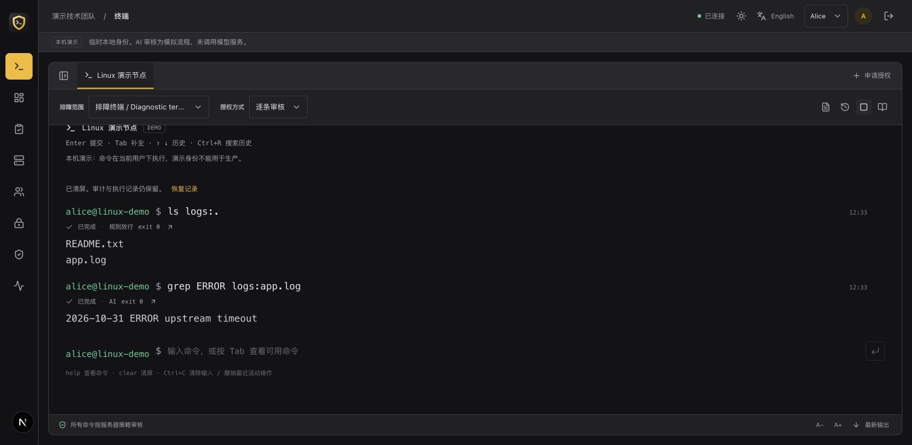
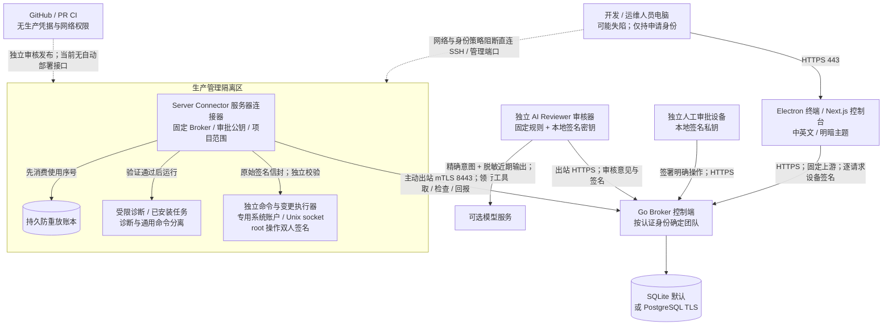
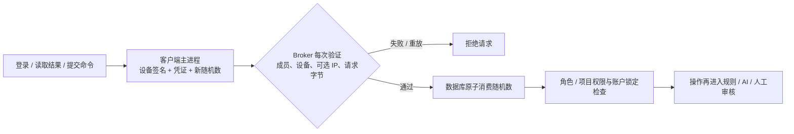
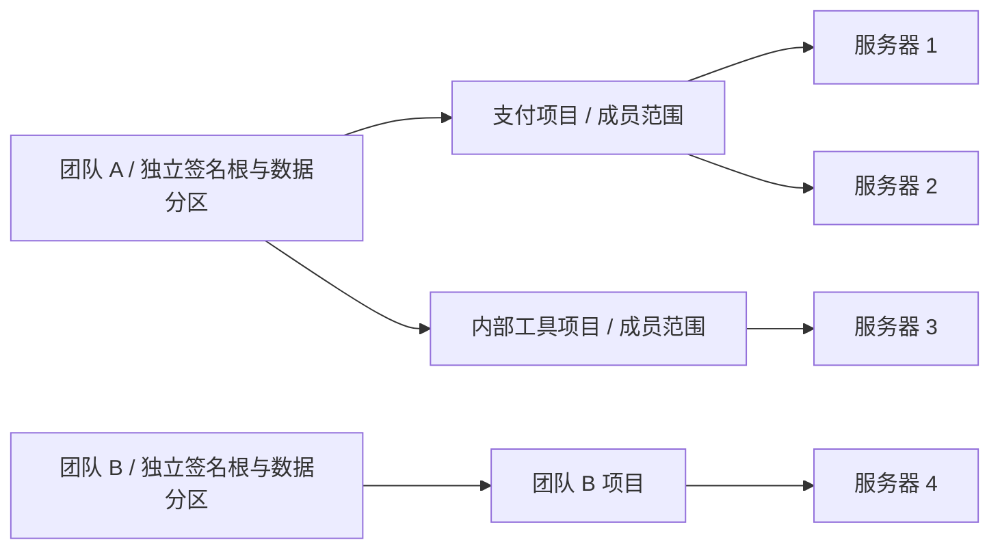
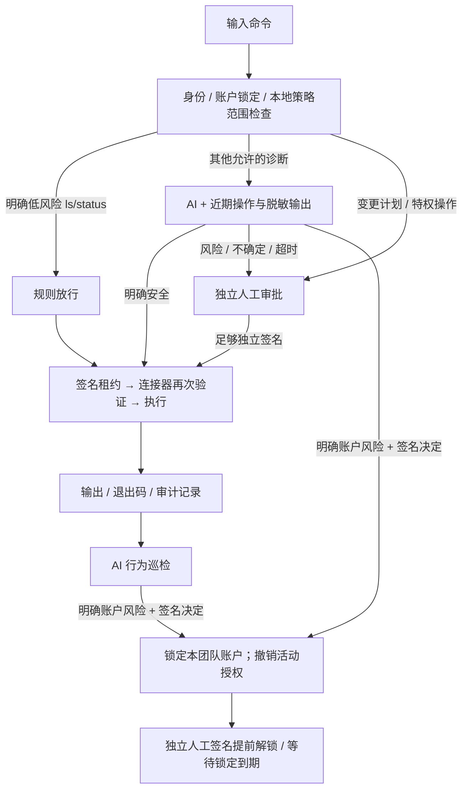

<div align="center">
    <h1>🛡️ safe-devops</h1>
    <h3><em>面向开发和运维团队的开源 DevSecOps 安全访问控制平台</em></h3>
</div>

<p align="center">
    <strong>让开发和运维人员申请操作，让服务器独立验证授权。支持设备身份验证、通用命令审核以及 AI 与人工分层审批，采用 Go、Next.js 和 Electron，支持 SQLite 或 PostgreSQL 自托管部署。</strong>
</p>

<p align="center">
    <a href="https://github.com/0xfnzero/safe-devops/releases">
        
    </a>
    <a href="https://github.com/0xfnzero/safe-devops/actions/workflows/ci.yml">
        
    </a>
    <a href="https://github.com/0xfnzero/safe-devops/blob/main/LICENSE">
        
    </a>
    <a href="https://github.com/0xfnzero/safe-devops">
        
    </a>
    <a href="https://github.com/0xfnzero/safe-devops/network">
        
    </a>
</p>

<p align="center">
    
    
    
</p>

<p align="center">
    <a href="https://github.com/0xfnzero/safe-devops/blob/main/README.zh-CN.md">中文</a> |
    <a href="https://github.com/0xfnzero/safe-devops/blob/main/README.md">English</a> |
    <a href="https://fnzero.dev/">Website</a> |
    <a href="https://t.me/fnzero_group">Telegram</a> |
    <a href="https://discord.gg/vuazbGkqQE">Discord</a>
</p>

safe-devops 用于降低“开发 / 运维日常电脑失陷 → SSH / GitHub 凭据被盗 → 横向进入生产”的风险。它不依赖开发 / 运维日常电脑上的确认弹窗：服务器连接器执行受限诊断、已安装任务、经逐条审核的通用 Shell 命令和变更计划，并验证独立签名、目录范围、期限和次数。开发与运维人员通过终端输入命令，不持有生产 SSH 私钥。

当前提供可运行的闭环及部署工具，**尚未经过独立安全审计，不应被视为已经验证的大规模生产 SaaS**。适合先在受控管理网络内试点。具体限制见 [安全边界](docs/architecture.md) 和 [验证记录](docs/validation.md)。本项目不对任何具体公司事故的经过作事实判断。



## 网络与信任边界



图中“阻断直连”依赖部署方的安全组、网络和身份治理，软件不会自动删除现有 SSH key 或修改防火墙。Broker 必须直接终止连接器 mTLS，不能把 `X-Client-Cert` 等 HTTP Header 当作身份。

名称明确区分：**Server Connector / 服务器连接器**负责验证并执行；**AI Reviewer / AI 审核器**负责评估并签名，没有服务器执行权限。CLI 使用 `safe-devops connector`；旧命令 `agent` 只是兼容别名。

## 设备与身份准入

新部署要求登记设备 SSH Ed25519 公钥。客户端先验证设备，再允许使用访问凭证；后续每个 API 请求都用设备私钥签名，绑定凭证、路径、内容、时间与一次性随机数，防止 token 异地复用及请求重放。管理员将设备绑定到指定成员，IP/CIDR 是可选附加条件。签名在 Electron 主进程中完成，密钥由系统密钥环保护。详见 [设备准入与逐请求验证](docs/device-access.md)。



设备签名由客户端自动完成，不要求每条命令重新输入密码。软件私钥持有证明不能保证物理机器不可克隆；若私钥与 token 同时被盗，或授权电脑仍由攻击者控制，必须继续依靠操作范围、独立审核和账户风控。当前未实现 TPM / Secure Enclave 硬件远程证明。

## 团队、项目与审批



同一控制端支持多个团队，每个团队多个成员、多个项目、每个项目多台服务器。成员只看到有权限的项目和任务；团队审计员可看本团队所有项目。租户来自已验证的 token 或客户端证书，不接受客户端指定租户。操作签名同时绑定团队与项目，连接器再次核对。

默认终端采用分层审核，明确通知申请人当前状态与转人工原因：



支持三种使用方式：逐条终端命令、一次批准的短时排障会话、一次批准完整顺序的变更计划。授权最长 15 分钟；固定任务最多 20 次，排障会话最多 100 次，管理员可设更低上限。会话批准后等待用户输入；固定任务/计划批准后排队。每次执行独立消费预算、检查租约和防重放账本。

AI 快照限定同一用户、团队、项目、服务器，最多最近 24 小时/10 条记录，输出脱敏和限长。新命令审核与执行后行为巡检都可以触发**账户锁定**；默认 15 分钟，可配置。锁定阻断新操作、撤销未完成授权并尽力取消运行任务。提前解锁必须独立人工签名，旧授权不会恢复。

**AI 有独立强制护栏**：模型无执行工具或签名密钥；管理员规则先于模型执行，Broker 与 Connector 再次核验。高风险 / 特权变更只接受人工签名。恶意 JSON、工具调用、越界命令和伪造锁定对象不会扩大权限；AI 仍可能在既定范围内误判。详见 [AI 权限护栏与边界](docs/ai-review.md#防止-ai-越权的强制护栏)。

终端支持通用命令、管道、重定向和软件安装操作，不要求逐个创建固定模板。明确安全的诊断快速放行，其余符合范围的只读命令交给 AI；未知、变更及复杂 Shell 操作转人工。每条 Shell 命令独立签署，不能复用排障会话授权；root 执行必须双人审批。生产通用命令使用独立 Linux 执行器和专用 OS 账户，目录是起始位置而非文件系统沙箱；`cd /path && 命令` 可指定执行目录，暂不提供 vim/top 全屏 PTY。新建本机演示会以当前非 root 用户执行获批命令，旧演示配置不会自动扩大权限。详见 [终端与桌面客户端](docs/terminal.md)、[账户风控](docs/account-risk.md)。

## 本机体验

需要 Go 1.26+、Node.js 22.18+（建议 24）、npm、Python 3.11+ 和 Make：

```bash
git clone https://github.com/0xfnzero/safe-devops.git
cd safe-devops
make                  # 查看全部命令及描述
make setup
make dev
```

打开 [http://127.0.0.1:3000](http://127.0.0.1:3000)。选择 Alice 发起支付项目任务，Dave 只可见沙箱项目，Bob / Carol 为人工审核者，审计观察员可看团队整体。

演示使用 `.safeops/v4`，旧数据保留。两台“服务器”由本机两个连接器模拟；AI 使用明确标记的本地模拟器，不调用外部模型。原因包含 `[human]` 可演示转人工；已授权会话内连续 5 次读取不存在的文件可演示账户锁定，随后由 Bob 在“账户风控”中签名解锁。演示身份与人工签名种子仅为本机体验，不可用于生产或通过公网代理暴露。

桌面客户端可运行 `make setup-desktop` 后 `make desktop`；或用 `make dev-desktop` 一起启动服务。开发、各平台打包及部署维护命令见 [命令手册](docs/commands.md)。生产安装方式见 [客户端说明](docs/terminal.md#electron-客户端)。

## Docker Compose 部署

默认只启动 Broker、Web、HTTPS 网关，**不需要 PostgreSQL**。初始化命令生成配置、令牌、证书、私有目录，拒绝覆盖已有目录。先在独立审批设备生成密钥，只把公钥带到管理设备：

```bash
safe-devops keygen --out /secure/reviewer.key
```

在可信管理设备的源码目录运行（将公钥和域名替换成实际值）：

```bash
make build
./bin/safe-devops init-compose --dir .safeops/production \
  --workspace acme --project payments \
  --broker-url https://broker.example.com:8443 \
  --web-url https://ops.example.com \
  --approver-public-key BASE64_PUBLIC_KEY \
  --device-public-key 'ssh-ed25519 YOUR_DEVICE_PUBLIC_KEY' \
  --diagnostic-root /srv/app/logs

./scripts/compose.sh .safeops/production config --quiet
./scripts/compose.sh .safeops/production up -d --build
./scripts/compose.sh .safeops/production ps
```

初始化默认生成私有 CA，需要在浏览器和审核设备信任 `credentials/ca.crt`，或换成公司 PKI 证书；不要跳过 TLS 校验。CA 私钥放在 `offline-ca/`，不挂载到容器，应转移离线保管。默认只发布到 `127.0.0.1`；部署到管理网络时在生成的 `.env` 设置 `SAFEOPS_BIND_ADDRESS=管理网IP`，配置对应 DNS 和入口访问策略。Broker 与 Web 必须使用不同宿主端口。

`--diagnostic-root` 可选，指向目标服务器上可读的业务日志目录，不能包含凭据。初始化同时生成 Broker/Connector 一致的终端范围；初始采用人工审核，ls/status 可规则放行。启用 AI 按 [审核部署说明](docs/ai-review.md) 配置独立审核器。

选择 PostgreSQL 时，初始化增加 `--database postgres`。同一个启动脚本自动叠加 PostgreSQL Compose 配置，启用证书校验、持久卷，数据库不发布宿主端口。**切换已有数据库须走备份恢复，不是直接修改选项。**

连接器安装在目标服务器，人工私钥和 AI 审核器部署在独立审批区域。容器版连接器只操作自己的容器，不具有宿主机管理能力；不要为方便而挂载 Docker socket 或开启 privileged。

完整的首次接入、原生 Docker、systemd、团队扩展、升级、备份与恢复步骤见 [部署指南](docs/deployment.md)。

## 配置与运维

- `init-config`：已有 PKI / systemd 环境的基础配置；`init-compose`：完整 Compose 初始化。
- `check-config`：严格 JSON、身份、策略、文件权限、TLS 配置检查，不写数据库。
- `/healthz`：进程存活；`/readyz`：数据库连接可用；`safe-devops health`：TLS 健康探测。
- `backup` / `restore`：按团队导出与恢复，可在 SQLite / PostgreSQL 间迁移；恢复只接受空分区并撤销活动授权。
- `policy-apply`：等待旧授权过期后更新策略指纹，保留审计；旧进程拒绝继续执行。
- `scripts/install.sh`：Linux systemd 安装、校验二进制 SHA-256、dry-run、升级备份。
- `make release VERSION=0.4.2`：Linux/macOS 双架构 CLI、当前平台 Next standalone、源码部署包和 SHA-256 清单。
- `make package-macos` / `package-windows` / `package-linux`：在对应系统生成 Electron 安装包。
- `make deploy-up` / `deploy-upgrade` / `deploy-backup`：Compose 启动、备份后升级及日常备份。

目前成员、项目、服务器与策略由可信管理员管理配置，UI 提供查看和日常申请审核；没有邀请注册、OIDC、在线权限编辑或计费。配置生命周期见部署指南，避免误把只读列表当作已实现的 SaaS 管理功能。

## 开发与验证

```bash
make test       # Go race tests + vet
make check      # 再检查 TypeScript、lint、生产构建
make smoke      # 需先运行 make dev
make test-scripts # 打包与部署脚本保护测试
```

`SAFEOPS_TEST_DATABASE_URL` 指向独立的 `*_test` 数据库时会运行 PostgreSQL 集成用例；SQLite 用例默认运行。CI 包含 Go、数据库、前端及容器部署测试。真实模型服务需要独立配置，不属于默认演示验证。

## 命名兼容

项目、界面、镜像与新部署入口统一为 `safe-devops`。为保留已有数据和协议兼容性，环境变量 `SAFEOPS_*`、演示目录 `.safeops/`、Go 内部模块名、数据库表名与 `safeops.*` 签名域保持不变；本地 `bin/safeops` 和镜像内 `safeops` 是旧 CLI 兼容入口。

## 当前边界

没有系统能保证终端失陷后“绝对不会入侵服务器”。预授权任务仍可被盗用；足够数量的审核设备、连接器宿主或可信管理通道失陷也会破坏隔离。固定命令必须来自管理员控制的不可写目录，命令摘要不等于二进制完整性证明。

SQLite 使用 WAL/FULL 与事务，适合单节点、适度规模。PostgreSQL 提供跨进程事务锁，但当前仍按团队存储完整 JSON 状态、校验完整审计链；不是高吞吐、无限历史或完整 HA 方案。共享 Broker 的管理员可访问各租户，要求强物理隔离的客户应分实例部署。审计链须配合独立外部归档；当前未内置 WORM 导出器。

详见 [架构与威胁模型](docs/architecture.md)、[AI 审核](docs/ai-review.md)、[GitHub 防扩散](docs/github-security.md)、[协议](docs/protocol.md)、[安全报告](SECURITY.md)。
