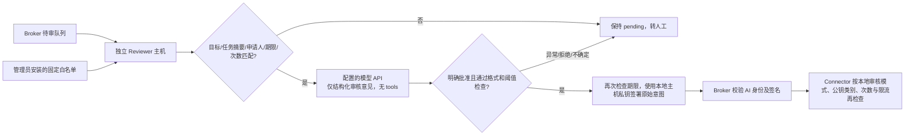

# AI 与人工审核 / v0.4

## 审核的单位是有限范围的授权

无需每执行一次 `ls` 都请人审批。管理员可以将固定目录、固定参数的只读任务设为 `auto`；其他常规任务可以一次审核，签署一个绑定目标、任务、申请人、有效期和最多次数的授权窗口。高风险任务只允许人工审核且每次重新申请。UI 提供受控命令终端，不提供任意 Shell。

Broker action 与 Connector runbook 都配置 `review`：

```json
{"mode":"ai","risk":"medium","max_uses":5,"rate_limit_per_minute":6}
```

- `auto`：仅 `risk=low`、`quorum=0`、`max_uses=1`，审批名单为空。每个请求自动授予一次执行，仍受本地限流限制。
- `ai`：仅 low/medium，必须同时配备足够的 AI 审核身份与人工回退身份。完整 AI 门槛或完整人工门槛任选其一，不混合凑数。
- `manual`：只允许人工审核身份。high 必须此模式且 max_uses=1；其他人工任务可以限次复用。

未设置 review 的旧配置默认 manual/high/一次，每分钟最多 6 次。固定任务 max_uses 最多 20，排障会话最多 100，速率每分钟 1–60 次。实际授权不得超过管理员上限，且最长 900 秒。速率按目标、任务和申请人组合分别计算，Broker 与 Connector 都检查；Connector 将速率记录与防重放状态一起落盘。

固定任务 / 变更计划授权通过后第一次自动排队；排障会话先进入 ready，等待命令。固定任务只有原申请人能触发 `/execute` 再次执行。每次租约签发即消耗预算，Connector 按 `(请求 ID, 使用序号)` 持久去重。失败或结果未知不自动重试。固定任务失败终结；会话单次诊断失败消耗预算但可在剩余范围继续，详见 [终端语义](terminal.md)。一次批准多个次数，意味着失陷终端在窗口内也可能用掉剩余次数；敏感操作应使用单次授权。

## 独立审核器如何工作



模型没有签名密钥、网络工具或执行工具，不能指定 argv 或放宽策略。`reason` 是不可信申请内容；适配器将其作为数据传入，提示模型不执行其中指令。但提示不是安全边界：即使模型错误批准，独立规则和 Connector 白名单仍然生效。置信度是模型自报值，不是校准过的安全概率。

只有 `approve` 签署原始操作 payload；`lock` 使用独立风控签名域，不能作为执行授权。`escalate`、`reject`、缺少字段、非法字段、低置信度、refusal、截断、超时、HTTP 错误、超大响应或 tool call 均不产生批准签名。AI 的 reject 表示拒绝自动授权，仍可由完整人工门槛批准；人工 reject 才将申请终结为 rejected。审核器离线时申请保持 pending，45 秒后自动标记转人工；申请人或有资格的人工审核者也可主动“转交人工审核”。

## 防止 AI 越权的强制护栏

把模型当作可能出错、被日志提示注入甚至刻意返回恶意结果的组件。系统提示词只是辅助，以下约束由普通 Go 代码与连接器强制执行：

- **能力隔离**：模型没有 tools、Shell、浏览器、网络抓取或数据库访问入口；只接收限定快照。模型 endpoint 由可信配置固定，不接受命令输入的 URL，禁止重定向与环境代理。模型看不到 Reviewer 的签名密钥。
- **先策略后模型**：独立 Reviewer 先匹配团队、项目、服务器、任务摘要、申请人、风险级别、有效期和次数；越界诊断、目录穿越、任意二进制或变更计划不会进入模型签名流程。
- **严格结果协议**：只接受 decision/reason/confidence 三个字段。工具调用（含旧 function_call）、未知/重复/大小写变体字段、伪造用户/命令/锁定时长、无效决定、截断、超时和低置信度全部转人工。置信度是模型自报值，只是额外过滤条件。
- **独立执行关卡**：Broker 从可信配置决定权限，Connector 再用本地规则、公钥和防重放账本验证。AI 签名不能修改任务、目录、次数、期限或凑成人工签名；人工拒绝或接管后，迟到 AI 批准不能恢复执行。高风险计划必须人工，特权计划至少双人。
- **限制 AI 服务身份**：AI token 只能获取分配的审核 / 巡检快照并提交决定；不能发起命令、触发执行、查看任意历史、改成员、改策略或解锁账户。行为巡检的 approve 只表示无需锁定，不产生执行授权。
- **锁定可追溯、可恢复**：锁定对象从原始请求 / 巡检确定，AI 无法选择其他成员或租户。锁定时长由管理员设置，默认 15 分钟；所有决定绑定证据摘要与签名。提前恢复需要独立人工签名，已撤销授权不会恢复，旧巡检不会在人工解锁后直接重放锁定。

这些护栏限制 AI 的能力，**不保证 AI 的语义判断正确**。恶意模型仍可能批准管理员允许 AI 审核范围内的不当请求，或误锁其可审核的账户。给 AI 的目录范围应排除秘密，任务应限制为可接受的诊断能力；安装、提权、凭证和策略变更保持人工专属。出现连续误报或异常审核时，先停止独立 Reviewer 服务并转人工，保留签名与审计后再排查 / 轮换 AI 身份。停止 Reviewer 不撤销已有授权，需同时撤销受影响请求；正在执行的副作用无法回滚。

## 配置真实模型审核器

1. 在独立可信主机创建无登录服务账户 `safe-devops-reviewer`，安装审核过的二进制。不要部署在开发 / 运维日常电脑、GitHub Runner、模型供应商主机或同一台不可信机器上。
2. 在此主机运行 `safe-devops keygen --out /etc/safe-devops/reviewer.key`。私钥仅本机专用账户可读；将公钥交给管理员，分别固定在 Broker principal 和 Connector `approver_keys`。
3. Broker principal 设置 `kind:"ai"`、`roles:["approver"]`，独立 token hash。Connector 对同一身份设置 `approver_kinds:{"ai-reviewer":"ai"}`。缺省 kind 为 human，所以必须明确安装 AI 类型；不相信租约中的显示字段。
4. 仅在允许 AI 的 action/runbook 中增加此身份，配置相同审核模式、风险、次数上限及人工回退名单。人工专属任务不能列 AI 身份。独立审核器自己的 rules 再次限制目标、任务摘要、申请人、风险、期限和次数。
5. 填写 [reviewer.example.json](../deploy/reviewer.example.json) 中明确的 `endpoint` 和 `model`，设置 `simulation:false`。模板不会替你选择模型或发送请求。接口是支持严格 JSON Schema 的 OpenAI-compatible Chat Completions，完整路径通常为 `/v1/chat/completions`。第三方兼容服务应先在测试环境确认支持 `response_format` 和 `store:false`，不兼容则转人工。
6. 在 0600 环境文件中设置 `SAFEOPS_REVIEWER_TOKEN` 与 `SAFEOPS_MODEL_API_KEY`，只填写值，不把密钥写入 JSON、CLI 参数、仓库或申请原因。使用 [systemd 服务模板](../deploy/safe-devops-reviewer.service) 启动；启动时核对 Broker 返回的身份、AI 类型和公钥是否匹配本地私钥。

示例运行：

```bash
safe-devops reviewer --config /etc/safe-devops/reviewer.json
```

Broker 和模型 endpoint 均要求 HTTPS/TLS 1.3，禁止自动重定向和环境代理，25 秒模型请求超时，最大 64 KiB 响应。审核器只需出站连接固定 Broker 与模型地址；用网络规则进一步限制目的地。Broker 私有 CA 可通过 reviewer 的 `ca` 配置，模型服务使用系统信任根。不要开启 `--demo` 连接生产。

模型 API 收到不可变申请意图、独立白名单，以及同一申请人/团队/项目/服务器的近期操作快照。快照最多 24 小时/10 条，每条输出最多 1 KiB、总输出最多 8 KiB；先脱敏再截断。不会发送认证令牌或签名私钥。快照摘要随审核意见记录，输出作为不可信证据而非指令。申请原因仍可能包含业务敏感信息，部署方应决定使用内部模型还是外部服务，并制定数据保留策略；`store:false` 不能代替供应商的数据政策。

结构化接口依据：[OpenAI Structured Outputs](https://developers.openai.com/api/docs/guides/structured-outputs)。本项目通过本地 HTTP 模拟服务测试接口、异常与完整执行链；本次开发未使用真实供应商密钥或验证某个真实模型的判断质量。

## 演示与验证

`make demo` 启动五个进程：Broker、两个 Connector、Reviewer 和 Next.js。Reviewer 使用明确标记的 `demo-policy-simulator`，模拟本地白名单内固定任务与受限诊断；后置巡检也在运行。原因含 `[human]` 时转人工，否则模拟批准；最近 3 次失败使命令审核转人工，5 次失败使行为巡检模拟锁定账户。无需 API key，也不会调用外部模型。AI token/签名种子不进入 `/api/demo`；人类临时签名种子为方便演示仍会公开给本机浏览器。

`make smoke` 检查固定目录 ls 自动执行、模拟 AI 审核、复用两次授权、转人工与 CLI 签名。Go 用例额外覆盖真实 HTTP 模型模拟服务 → Reviewer 签名 → Broker → Connector 执行，以及拒绝/截断/格式异常、AI 冒充人工、次数篡改和重启重放。

## 范围与升级

审核器配置必须固定 workspace_id，每条规则包含 project_id；模型不能选择或改写租户。服务器连接器与 AI 审核器是两个组件，前者用 `safe-devops connector`，后者用 `safe-devops reviewer`。

容器部署使用 `deploy/compose.reviewer.yaml`，放在独立审核主机。该主机自行生成签名密钥，只把公钥安装到 Broker 与连接器。配置目录包含 reviewer.json、reviewer.key、broker-ca.crt、reviewer.env；环境文件只含该审核器 token 和模型密钥，权限 0600。设置正确 SAFEOPS_CONFIG_DIR、SAFEOPS_UID/GID 后启动，不向模型或 Web 挂载密钥。

当前演示目录为 `.safeops/v4`，保留旧演示数据。Intent v3 绑定团队与项目，Lease v2 绑定使用序号。旧账本消费记录继续生效，不可回滚。更新策略与身份需等待旧授权过期后运行 policy-apply，详见 [部署维护流程](deployment.md#7-升级策略变更和证书续期)。

## 行为巡检与账户锁定

Reviewer 同时轮询待审队列与执行后风险队列。模型可输出 lock，达到置信度阈值后签署专用风险决定；Broker 从记录确定被锁申请人，并撤销整个团队内其活动授权。默认锁定 900 秒，提前解锁要求独立人工签名。详见 [账户风控与恢复](account-risk.md)。服务器至少需一个 AI 模式 action，Reviewer 独立规则必须覆盖该服务器用于巡检的首个 AI action；未配置 AI 的服务器不会自动调用模型。
