# 设计与威胁模型

## 要防止的攻击链

终端被控制后，攻击者可能读取磁盘上的 SSH 私钥、利用 ssh-agent 签名、盗用浏览器会话、拿走 GitHub PAT、修改工作流或窃取云管理令牌。单纯加 VPN、跳板机或在同一台电脑上弹出确认窗口，不能可靠切断这些路径。

传统堡垒机仍有价值：会话录像、集中授权、凭据托管、JIT 权限都比分散的长期私钥好。但一条获批的任意 shell 对完全失陷的终端而言仍然是可操纵的生产会话。safe-devops 提供**受控命令终端、排障会话和已安装的变更计划**，不开放通用 shell。

## 分层防护

**基础设施层**：生产运维端口仅允许独立管理网络或完全关闭 SSH 入站；清除个人 authorized_keys；禁用开发者到生产的 SSH agent forwarding；数据库、云 IAM、Kubernetes kubeconfig、VPN、CI secrets 也要同步拆分。公网业务端口与运维端口分别处理，不能为了演示直接封禁全部流量。

**身份层**：开发者只能申请，不拥有 Connector 凭据、审批私钥或控制端私钥。审批人与申请人不能是同一主体。生产建议审批人在专用设备上使用硬件保护的签名密钥。新部署要求管理员登记机器公钥；每次人工 API 请求都验证身份凭证与绑定请求字节的设备签名，一次性随机数在数据库中原子消费。可选 IP 条件由服务端检查。Electron 用系统密钥环保护软件私钥，独立审批仍使用独立签名；尚未实现不可导出硬件密钥或物理机器远程证明。见 [设备准入](device-access.md)。

**授权层**：签名绑定版本、团队、项目、随机请求 ID、服务器、任务 ID、argv/超时摘要、申请人、操作原因、最多执行次数和 30–900 秒有效期。任务策略为 auto / ai / manual；需要审核的任务达到同类门槛后才能签发指定 Connector 的短期租约，自动任务只限低风险。每个租约消耗一次预算。开发 / 运维人员可以选择已授权目录内的文件路径、搜索文本和受控步骤顺序；不能提交任意 shell、argv、仓库 URL 或下载 URL。

**执行层**：Connector 只主动连接固定控制端，并校验服务端 TLS。控制端以专用 CA 签发的客户端证书识别 Connector，证书 CN 精确映射到目标。Connector 还必须独立验证本地认可的审核模式、公钥种类与人数，执行内置文件诊断、已安装任务或按原顺序签署的变更步骤。特权计划须由独立执行器验证至少双人人工签名。控制端单独失陷不足以伪造新的人工/AI 签名；自动任务的预授权能力仍可能被触发，但仍能拒绝服务、谎报界面数据、干扰取消或在有效期内使用真实授权。

**供应链层**：GitHub 代码变更不直接成为生产执行权限。工作流和发布策略由独立 CODEOWNERS 审查；PR Runner 无生产网络和凭据；制品构建与部署授权分离。v0.4 不实现制品发布供应链，因此不存在让开发者直接下发 `git pull` 的接口。

**AI 护栏层**：模型只有结构化意见，没有执行工具、签名密钥或策略写权限。独立审核器先检查管理员规则、精确意图、期限、次数和诊断语法，再接受严格 JSON 决定；Broker 与 Connector 各自复核。高风险 / 特权计划不能由 AI 批准。账户锁定仅限被审请求的申请人，期限由管理员配置，AI 不能解锁。恶意模型仍可能误批允许范围内的操作或造成误锁，不能把置信度当成安全证明。

## 权限与信任根

- requester：仅能对目标策略中允许的任务发起申请，撤销自己的活动请求。
- approver：仅可批准策略允许的他人请求；必须提供匹配其固定公钥的独立签名；可撤销该范围内请求。
- AI reviewer：kind 为 ai，仅能读取待审/行为巡检队列并提交受限意见；独立主机保管签名密钥。本地规则先于模型执行，不能批准高风险或人工专属任务。
- auditor：读取全部审计和申请，不获得操作/审批权限。
- connector：只接收、检查、回报绑定目标的任务，不是人员身份。
- 可信管理者：安装 Connector、管理本地策略/审批公钥、配置网络与组织权限。其管理设备和通道必须独立，不能仍由被假设失陷的开发 / 运维人员电脑控制。

团队由认证 token 或 mTLS 证书选择，禁止客户端租户选择器。每个团队有独立 Broker 签名根和数据库分区；项目成员决定目录可见范围，申请详情仅原申请人、该任务审批人和本团队审计员可读。签名绑定团队与项目，连接器再次校验。共享 Broker 管理员仍然可信，应用层分区不是物理隔离。

## 状态与故障语义

```mermaid
stateDiagram-v2
  [*] --> pending: AI 或人工审核请求
  [*] --> approved: 低风险预授权
  pending --> approved: 任务 / 计划满足审核门槛
  pending --> ready: 排障会话满足审核门槛
  pending --> rejected: 人工拒绝
  pending --> pending: AI 不确定或拒绝，转人工
  approved --> running: 单次原子领取
  running --> completed: exit 0 且次数用完
  running --> ready: exit 0 且仍有预算
  ready --> approved: 申请人主动再次执行
  ready --> revoked
  ready --> expired
  running --> ready: 会话单次失败且仍有预算
  running --> failed: 任务 / 计划非零退出
  pending --> expired
  approved --> expired
  running --> expired: 租约截止 / 结果未知
  pending --> revoked
  approved --> revoked
  running --> revoked: 尝试取消
```

领取提交后、响应到达前断网，会导致授权消费但命令没执行；Connector 记录消费后、启动进程前崩溃也一样。设计偏向 **每个请求使用序号至多执行一次**，不声称 exactly-once，不自动重发不确定任务。执行结果提交失败时，不会重跑命令；后续标记过期，需人工确认实际效果。

控制端撤销后，Connector 大约每秒复查一次，单次检查最多 1.5 秒；无法验证授权则取消进程组。取消不能撤销已产生的副作用，也不是即时强制隔离。程序可脱离进程组或 fork 特殊进程，因此白名单必须只包含可信工具；生产还要使用 systemd/cgroup、专用用户与资源限制。

## 数据与审计

默认 SQLite。旧演示文件存储保留兼容实现，使用文件排他锁、临时文件、fsync 与原子 rename。Connector 独立保存已消费请求 ID，加使用序号与每分钟限流记录，并在执行前落盘。不能删除或回滚其账本，否则会失去防重放保障。

生产可选 SQLite 或 PostgreSQL，统一按 workspace ID 保存 JSON 状态文档。SQLite 使用 WAL、FULL、立即事务和单连接；PostgreSQL 使用行锁，每个团队独立串行更新。schema 版本控制拒绝未知新版本。该模型适合适度规模，仍会加载、重写和验证完整历史，不适合高吞吐或无限增长。需要更大规模时须进一步规范化表、索引、分页、归档和分布式限流。备份可跨后端迁移，恢复只允许同团队空分区并撤销活动授权。

审计哈希链只能检测缺少重算能力的局部修改。能重写整个数据库的人也能重算链；必须持续导出到独立 WORM/对象锁/SIEM，并保存外部检查点。当前不包含该导出器。Connector 回报结果也不等于硬件证明。

## 剩余风险与安全假设

- 自动任务允许失陷终端触发预授权能力；AI 模型可能误判或受提示注入影响，不能把模型意见当成安全证明。固定白名单限制它可批准的范围。详见 [AI 审核边界](ai-review.md)。
- 开发者与足够数量的审批设备同时失陷，或审批人被诱导批准恶意任务，仍可获得真实授权。
- 文件密钥无法证明人的在场；在同一台开发 / 运维日常电脑上运行审批 CLI 不构成隔离。
- Broker 的 revoke/check 通道可信性在控制端失陷后不再成立；本地期限、按使用序号去重的账本与固定策略仍约束执行。
- 固定任务摘要覆盖 argv 和 timeout；诊断 / 计划摘要还覆盖工具、目录或安装步骤；不覆盖可执行文件、动态库、脚本内容和环境外部状态。命令及依赖必须 root 管理，不能来自开发者可写目录或自动拉取的仓库。
- 固定命令不是操作系统沙箱。不能把 `sh -c`、可写脚本、通用包管理器、任意容器运行、可加载插件的工具或能执行 hook 的程序开放为低风险 / AI 任务。需要安装服务时，由管理员安装精确变更步骤并要求人工审核；步骤本身及包源仍需独立安全评估。
- 日志读取、诊断导出本身可能泄露数据；需对具体 runbook 做安全评估。API 不应公开到互联网，仅放于认证管理入口和受控网络。
- 时间有效性依赖可信系统时钟；生产维护 NTP 与时钟异常监控。
- 无法替代 EDR、主机补丁、磁盘加密、供应链扫描、云 IAM 与独立应急恢复。
- 当前采用维护窗口更新身份/策略：等待旧授权全部过期，运行 policy-apply 保留历史并记录策略指纹。不是在线无停机吊销；紧急事件应先用独立网络管理通道隔离。

## 产品路线

第一阶段为本仓库已经实现的受限任务闭环。第二阶段接入 OIDC、独立 WebAuthn/硬件审批签名、身份生命周期、审批策略管理和正式数据库迁移。第三阶段加入独立发布构建、制品摘要签名与可验证部署。团队与项目的应用隔离已实现；公网 SaaS 的身份生命周期、计费、区域物理隔离与高可用调度仍待建设。

已有 Teleport、Boundary、BastionZero、传统 PAM/堡垒机与云 Session Manager 等成熟产品可用于身份化访问。本项目的差异是优先限制“能做什么”，并要求服务器自己验证审核策略与独立签名。完整替代这些产品需要更多功能与第三方安全审计。
